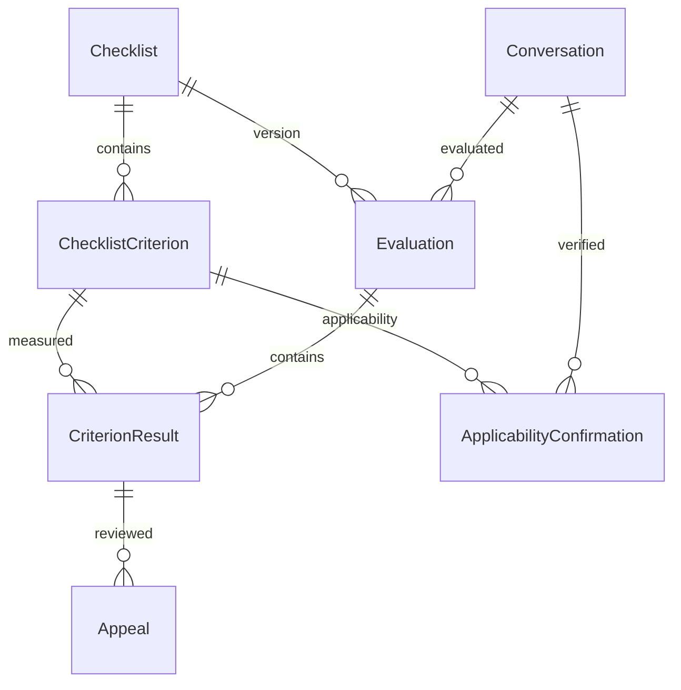

# Модель данных CQA MVP



| Таблица | Назначение |
| --- | --- |
| Conversation | Уникальный ID организаторов, язык RU/KZ/EN, канал, аудио и исходный транскрипт. |
| Checklist | Версия чек-листа: уникальная пара key + version, название и JSON конфигурация. |
| ChecklistCriterion | Критерии этой версии: ключ, название, максимальные баллы и JSON конфигурация. |
| Evaluation | Оценка диалога по одной версии чек-листа, DRAFT или COMPLETED. |
| CriterionResult | Исходные баллы / N/A, объяснение и доказательства по критерию. |
| Appeal | Комментарий, PENDING/ACCEPTED/REJECTED, проверяющий, причина решения и пересмотренные баллы / N/A. |
| ApplicabilityConfirmation | Независимое подтверждение N/A для диалога, версии и критерия; источник и проверяющий. |

Этап 5 добавляет nullable Evaluation.provider/transport/score/aiResponse и
CriterionResult.answer/checkedRange/naReason без переписывания старых записей.
score хранит нормализованный результат Scoring Engine, points сохраняет прежнее
значение сырой шкалы. Полный исходный AI-ответ остаётся в aiResponse.
Подтверждения N/A неизменяемы; публичной записи через HTTP нет.
Миграция 006 и контракт хранения описаны в [evaluations.md](evaluations.md).
Миграция 007 добавляет Appeal.decision/revisedAnswer/revisedNaReason/beforeScore/afterScore.
Решение и снимки пересчёта сохраняются в Appeal, исходная Evaluation не обновляется.
CONFIRM соответствует REJECTED, CHANGE — ACCEPTED. Контракт этапа 6: [appeals.md](appeals.md).

## Версии и ограничения

`Conversation.externalId` — обязательная уникальная строка ID организаторов.
Повторный импорт должен использовать этот ключ через `upsert` или `ON CONFLICT DO NOTHING`;
второй `create` с тем же ID отклоняется. Нормализацию ID определит будущий импортер;
сейчас сравнение точное и чувствительное к регистру.

Один диалог имеет не более одной Evaluation на конкретную версию Checklist.
Checklist и ChecklistCriterion неизменяемы: новую редакцию создают новой версией
в одной транзакции с критериями. Критерии можно добавлять только до первой Evaluation.
Для исправления даже неиспользованного критерия создаётся новая версия — это упрощение
MVP без интерфейса редактирования черновиков чек-листа.

Составной внешний ключ гарантирует совпадение версии критерия и Evaluation.
Пара evaluationId + criterionId уникальна. Баллы — Decimal(12,4), от 0 до maxPoints.
Для N/A баллы должны быть NULL; ноль означает применимый критерий с нулевым результатом.
Версия положительная, ключи и названия непустые, конфигурации — JSON-объекты.
Начиная с этапа 3 флаг type=flag имеет maxPoints=0 и weight=0; он не даёт баллов.
Редактор хранит типы, веса, описания, шкалы, N/A и sectionKey в config критерия,
секции и инструкции — в config чек-листа. Управляемые редактором конфигурации имеют
schemaVersion=1; прежние config без этого поля остаются совместимыми.
Внешние ключи используют RESTRICT, история не удаляется каскадно.

Evaluation создают как DRAFT, добавляют все CriterionResult и только затем переводят
в COMPLETED с completedAt. Будущий сервис должен выполнять это в транзакции.
Завершение допускается только при наличии результата для каждого критерия.
После завершения Evaluation и CriterionResult нельзя обновлять или удалять.
Транскрипт и остальные поля Conversation фиксируются при создании первой Evaluation.

## Транскрипт и доказательства

`Conversation.transcript` — JSON-массив, индекс реплики начинается с **0**.
Порядок массива является частью исходных данных:

```json
[
  { "speaker": "operator", "text": "Здравствуйте!", "startMs": 0, "endMs": 1200 },
  { "speaker": "client", "text": "Добрый день", "startMs": 1500, "endMs": 2400 }
]
```

`CriterionResult.evidence` — массив, например:

```json
[{ "turnIndex": 0, "quote": "Здравствуйте!" }]
```

База проверяет целочисленный неотрицательный turnIndex и существование этой позиции
в транскрипте данного диалога. Несколько доказательств могут ссылаться на разные реплики.
`quote` — вспомогательный текст; его совпадение с репликой и формат полей самой реплики
нужно валидировать в будущем импортере. Пустой массив допустим для отсутствующего действия
или N/A. KZ — согласованное обозначение проекта для казахского языка.

## История апелляций и итоговые баллы

Апелляция относится к одному CriterionResult завершённой оценки.
Одновременно разрешена одна PENDING-апелляция на результат.
Исходный комментарий и принадлежность апелляции неизменяемы; удаление запрещено.
Для решения нужны reviewer и непустая decisionReason. ACCEPTED дополнительно требует
revisedIsNa и соответствующие revisedPoints. REJECTED не содержит новых баллов.
База выставляет decidedAt и обеспечивает порядок решений на одном критерии.
После решения запись неизменяема; последующий пересмотр оформляют новой апелляцией.
Reviewer пока строковый ID — учётные записи пользователей не входят в этот этап.

Read-only SQL views (не Prisma-модели):

- `"EffectiveCriterionResult"`: исходные и текущие баллы/N/A, ID последней принятой апелляции.
- `"EvaluationTotals"`: originalPoints / originalMaxPoints и effectivePoints / effectiveMaxPoints.

Views возвращают только завершённые оценки. Последняя ACCEPTED заменяет результат
своего критерия; последующая REJECTED не отменяет ранее принятую апелляцию.
Исходные значения остаются в CriterionResult. N/A исключает максимум критерия
из соответствующей суммы. Если все критерии N/A, обе итоговые суммы равны 0;
это не процент качества и не повод делить на ноль.

Безопасное параметризованное чтение через общий Prisma Client:

```js
const totals = await prisma.$queryRaw`
  SELECT * FROM "EvaluationTotals" WHERE "evaluationId" = ${evaluationId}::uuid
`;
```

Это суммы обычных баллов, без весов, процентов, штрафов или алгоритма scoring.
Нормализованный scoring этапа 4 описан в [scoring.md](scoring.md) и вызывается отдельно;
эти исторические views не изменены. Апелляция с 6 → 9 баллов
изменяет effectivePoints; originalPoints остаётся 6.

## Миграции

Первая миграция создаёт модели, индексы и FK. Вторая добавляет SQL CHECK, триггеры,
частичный уникальный индекс и views. Блокировки родительских строк сериализуют
добавление результатов/завершение оценки и решения по одному критерию.
Используйте миграции как источник SQL-ограничений: Prisma schema не описывает их полностью.
Миграции 003–005 добавляют ограничения редактора, поддержку исходного порядка шкал
и флагов без баллов; миграции этапов 1–2 сохранены. Отложенные constraint triggers
проверяют сумму весов, ссылки на секции и порядок критериев при завершении транзакции.
Ввод HTTP API дополнительно проверяется Zod. Контракт: [api.md](api.md).

Официальные источники: [Prisma PostgreSQL adapter](https://www.prisma.io/docs/orm/v7/core-concepts/supported-databases/database-drivers),
[Prisma JS config](https://www.prisma.io/docs/orm/v7/reference/prisma-config-reference),
[PostgreSQL Docker image и volume для версии 18](https://hub.docker.com/_/postgres).
